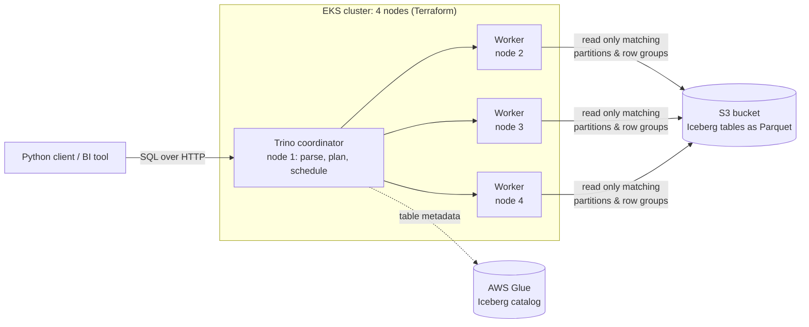

# Distributed SQL Query Engine on Kubernetes

A distributed **Trino** cluster (1 coordinator + 3 workers) running on **Kubernetes**, querying
partitioned **Apache Iceberg / Parquet** tables on **AWS S3**. All infrastructure is provisioned
with **Terraform**, and a **Python** toolkit loads data and benchmarks how much **partition
pruning** and **predicate pushdown** speed queries up.

**Stack:** Trino · Kubernetes (EKS) · Docker · Terraform · AWS S3 · AWS Glue · Apache Iceberg · Parquet · Python

---

## Architecture



| Layer | What it does | Where |
|---|---|---|
| **Terraform** | VPC, S3 gateway endpoint, EKS with two node groups (1 coordinator + 3 workers), encrypted S3 bucket, Glue database, least-privilege IAM role (IRSA) | [`terraform/`](terraform) |
| **Kubernetes** | Coordinator + worker Deployments, node pinning, one worker per node (pod anti-affinity), health probes, graceful worker shutdown, PodDisruptionBudget | [`k8s/`](k8s) |
| **Docker** | Same 1 + 3 topology on a laptop, with MinIO (S3) and an Iceberg REST catalog | [`docker/`](docker) |
| **Python** | Loads TPC-H into partitioned Iceberg tables, runs the benchmark, writes a report | [`python/`](python) |
| **CI** | Lint + unit tests, `terraform validate`, Kubernetes schema check, Docker build | [`.github/workflows`](.github/workflows) |

---

## How the query optimizations work

Both setups hold **the same rows**. Only the table layout and engine settings change.

| | Baseline | Optimized |
|---|---|---|
| Table layout | `lineitem_flat`, `orders_flat`: no partitions, unsorted | Partitioned by `month(shipdate)` / `month(orderdate)`, sorted by `orderkey` |
| Partition pruning | Not possible: every file is read | Iceberg metadata skips months outside the `WHERE` range before any file is opened |
| Predicate pushdown | Parquet min/max stats rarely help on unsorted data | Sorted files give tight min/max per row group, so Parquet column indexes and bloom filters skip most of them |
| Dynamic filtering | Off | On: the small side of a join (e.g. one month of `orders`) is pushed into the scan of the big side (`lineitem`) |

You can see pruning directly in the plan:

```sql
EXPLAIN ANALYZE
SELECT count(*) FROM iceberg.tpch_lake.lineitem
WHERE shipdate >= DATE '1995-01-01' AND shipdate < DATE '1995-04-01';
-- Compare "Input: ... rows / ... MB" with the same query on lineitem_flat
```

The benchmark ([`python/tqe/bench.py`](python/tqe/bench.py)) runs the 5 queries in [`queries/`](queries)
against both setups (1 warm-up + N measured runs each) and reports median latency and bytes scanned in
`results/benchmark.md`.

---

## Quick start: local (Docker)

Needs Docker with about 8 GB RAM.

```bash
make local-up             # MinIO + Iceberg REST + 1 coordinator + 3 workers
make local-load           # TPC-H sf1 -> Iceberg/Parquet in MinIO
make local-bench          # writes results/benchmark.md
make local-down
```

Trino UI: http://localhost:8080 · MinIO console: http://localhost:9001 (`minioadmin` / `minioadmin`)

## Deploy on AWS (Terraform + EKS)

Needs `terraform`, `aws` CLI (logged in), `kubectl`, Python 3.10+.

```bash
cp terraform/terraform.tfvars.example terraform/terraform.tfvars   # optional: edit region / sizes
make infra-init
make infra-apply          # VPC, EKS (4 nodes), S3, Glue, IAM
make deploy               # Trino on EKS: waits until all pods are ready

kubectl -n trino port-forward svc/trino-coordinator 8080:8080 &   # in another terminal
pip install -r python/requirements.txt
make cloud-load SCALE=sf10
make cloud-bench SCALE=sf10

make infra-destroy        # stop paying for it
```

`scripts/deploy.sh` reads `terraform output` and writes the account-specific values (region, IAM role ARN)
into the Kubernetes overlay, so nothing account-specific is committed. Pods get S3 and Glue access through
IRSA, with no static AWS keys.

---

## Repository layout

```
terraform/            VPC, EKS (coordinator + worker node groups), S3, Glue, IAM (IRSA)
k8s/base/             Trino Deployments, Service, PDB, configs (Kustomize)
k8s/overlays/eks/     EKS-specific values, generated by scripts/deploy.sh
docker/               Local 1+3 cluster with MinIO + Iceberg REST, benchmark image
python/tqe/           Data loader, benchmark runner, report generator (+ unit tests)
queries/              Benchmark SQL (date-range scans, joins, point lookups)
results/              Benchmark output
```

## Development

```bash
pip install -r python/requirements-dev.txt
make test     # unit tests
make lint     # ruff, terraform fmt, kustomize build
```
